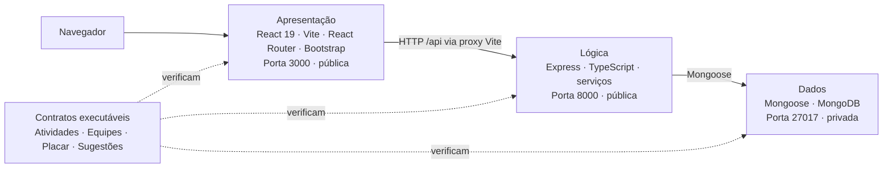

# Arquitetura do OctoFit Tracker

O OctoFit Tracker é uma aplicação de três camadas para um programa de atividades físicas escolar. O código inicial inclui contratos de API e pontos de implementação intencionalmente incompletos para que você use o modo agent do GitHub Copilot em um ciclo guiado por testes.

## Limites entre as camadas

- **Camada de apresentação**: React 19, Vite, React Router, Bootstrap e um cliente compartilhado da API em `octofit-tracker/frontend/src`.
- **Camada de lógica**: rotas e serviços Express com TypeScript em `octofit-tracker/backend/src` expõem o comportamento `/api/*` na porta `8000`.
- **Camada de dados**: modelos Mongoose e dados de demonstração em `octofit-tracker/backend/src/models` e `src/scripts/seed.ts` são persistidos no MongoDB na porta `27017`.

## Portas e regras de ambiente

- MongoDB: `27017` (privada)
- API Express: `8000` (pública)
- Interface Vite: `3000` (pública)
- O navegador acessa caminhos relativos `/api`. O Vite os encaminha para `http://localhost:8000`; `VITE_API_BASE_URL` pode substituir a URL-base.
- Não encaminhe nem torne públicas outras portas.

## Contrato da API

| Capacidade | Método e caminho | Comportamento esperado |
| --- | --- | --- |
| Registro de atividades | `GET /api/activities`, `POST /api/activities` | Lista e cria atividades válidas. POST recebe `userId`, `teamId`, `type` e `minutes`; `userId` e `teamId` devem ser IDs bem-formados de uma pessoa e uma equipe existentes, caso contrário a API retorna um 4xx intencional (nunca um 500 causado por erro de conversão). Uma atividade criada armazena `user`, `team`, `type` e `minutes` enviados, além de `points` e `occurredAt` calculados. |
| Equipes | `GET /api/teams`, `POST /api/teams` | Lista e cria equipes com integrantes. As equipes criadas e listadas mantêm os valores enviados em `name` e `mascot`. Rejeita uma equipe sem nome com `400`. |
| Placar | `GET /api/leaderboard` | Retorna as equipes ordenadas pela soma dos pontos de suas atividades, da maior para a menor. Cada item contém `teamName`, `totalPoints` e uma `rank` iniciada em 1. |
| Sugestões de treino | `GET /api/workouts/suggestions/:userEmail` | Recomenda treinos com base nos padrões de atividade recentes da pessoa correspondente ao e-mail seed. O foco da primeira sugestão (`focus`) corresponde à meta ou à atividade recente dessa pessoa, e o campo `reason` explica o motivo. Um e-mail sem pessoa correspondente retorna um 4xx intencional (por exemplo, `404`). |

## Decisões de implementação

Registre seu plano aqui antes de editar o código.

- Decisão da camada de apresentação: cada página (`/activities`, `/teams`, `/leaderboard`, `/workouts`) consome o cliente compartilhado `octofit-tracker/frontend/src/api/client.ts`, que chama caminhos relativos `/api`. Substituímos o texto "Implementação pendente" de `CapabilityCard` por estados de carregamento, vazio e erro, anunciados com `role="status"` e `role="alert"`. A página não contém regra de negócio.
- Decisão da camada de lógica: as rotas em `octofit-tracker/backend/src/routes/api.ts` apenas recebem a entrada HTTP e delegam a `octofit-tracker/backend/src/services/octofitService.ts`, onde ficam as regras. Entradas inválidas, incluindo IDs malformados e referências inexistentes, retornam 4xx intencional, nunca 500.
- Decisão da camada de dados: as regras de integridade ficam nos modelos Mongoose em `octofit-tracker/backend/src/models`, com campos obrigatórios: `name`, `email` e `fitnessGoal` em `User`; `name` e `mascot` em `Team`; `type`, `user`, `team`, `minutes`, `points` e `occurredAt` em `Activity`; `focus`, `minutes` e `difficulty` em `Workout`. O seed e a criação de registros passam sempre pelos modelos, com upsert idempotente, sem scripts diretos no MongoDB.
- Abordagem para registro de atividades: o serviço valida `userId` e `teamId` como ObjectIds de pessoa e equipe existentes antes de salvar; se falhar, retorna 4xx e não cria documento. `user` e `team` recebem esses IDs, `points` é igual a `minutes` (um ponto por minuto) e `occurredAt` recebe a data do servidor no momento do registro. A regra de pontos fica no serviço, não na rota.
- Abordagem para gerenciamento de equipes: `name` e `mascot` são obrigatórios (`400` quando ausentes). `members` é opcional, aceita IDs de pessoas e assume lista vazia por padrão. A listagem devolve `name` e `mascot` exatamente como foram salvos.
- Abordagem para o placar: agregar os pontos das atividades por equipe, ordenar de forma decrescente por `totalPoints` e numerar `rank` a partir de 1. Cada item traz `teamName`, `totalPoints` e `rank`, e a resposta usa a chave `leaderboard`.
- Abordagem para sugestões de treino: buscar a pessoa pelo e-mail e retornar `404` quando não houver correspondência. O `focus` vem da meta (`fitnessGoal`) da pessoa, e o treino com esse foco fica em primeiro lugar em `suggestions`. `reason` explica o motivo em texto e cita a atividade recente, traduzida para o português (por exemplo, `run` como corrida e `strength` como força).

## Plano de testes

Registre os comandos executados e o significado de cada falha.

- Testes da camada de dados: `npm run test:data --prefix octofit-tracker/backend`
- Testes da API: `npm run test:api --prefix octofit-tracker/backend`
- Testes do frontend: `npm test --prefix octofit-tracker/frontend`
- Compilação do backend: `npm run build --prefix octofit-tracker/backend`
- Compilação do frontend: `npm run build --prefix octofit-tracker/frontend`

### Resultados da linha de base

Executados a partir da raiz do repositório, antes de qualquer implementação:

- `npm run test:data --prefix octofit-tracker/backend`: 4 de 5 falham. As validações obrigatórias de `User`, `Team`, `Activity` e `Workout` não são geradas, então o modelo ainda aceita documentos incompletos. O teste de inserção idempotente passa.
- `npm run test:api --prefix octofit-tracker/backend`: 4 de 4 falham.
  - `POST /api/activities` e `POST /api/teams` retornam `501` (rota pendente) em vez de `400` para entradas inválidas.
  - `GET /api/leaderboard` retorna `[]` em vez do ranking esperado, porque a agregação ainda não existe.
  - `GET /api/workouts/suggestions/:userEmail` retorna a sugestão sem o campo `reason`.
- `npm test --prefix octofit-tracker/frontend`: 15 de 15 falham. Os erros são timeouts de cerca de 1 s em `waitFor`, e a página de sugestões exibe apenas "Implementação pendente". A causa exata dos demais casos ainda precisa ser confirmada.

Ordem de validação: dados, depois API, depois frontend. Cada etapa deve ficar verde antes de avançar.

Etapa 1 — Arquitetura: entender as camadas, registrar decisões e identificar as falhas iniciais dos testes.
Etapa 2 — Dados: implementar os modelos MongoDB e garantir que os dados de demonstração sejam idempotentes.
Etapa 3 — API: implementar e validar as regras e os endpoints do backend.
Etapa 4 — Interface: criar as telas React, incluindo estados de carregamento, vazio e erro.
Etapa 5 — Integração: testar e compilar o sistema completo, revisar a pull request e mesclá-la.